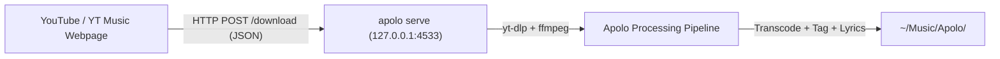

# Browser Extension & Local Server

Apolo includes a **Manifest V3** browser extension located in [`plugins/youtube`](../plugins/youtube) that injects native download and library ingestion buttons directly into **YouTube** and **YouTube Music**.

---

## 1. How It Works



1. The browser extension observes pages on `youtube.com` and `music.youtube.com`.
2. Injects clean, native-styled action buttons into players and playlist headers.
3. Clicking a button dispatches an asynchronous download task to Apolo's local REST daemon running on `http://127.0.0.1:4533`.
4. Apolo downloads the track, converts to Opus, tags it with high-res cover art and synced lyrics, and moves it directly into your organized music library.

---

## 2. Launching the Local Server (`apolo serve`)

To receive requests from the extension, the Apolo daemon must be active.

### Manual Launch
```bash
apolo serve
```
*(Runs on `http://127.0.0.1:4533` with CORS enabled for local extension origins).*

### Automated Autostart with Systemd User Service

To keep `apolo serve` running silently in the background whenever you log into your desktop:

1. Create `~/.config/systemd/user/apolo-server.service`:

```ini
[Unit]
Description=Apolo Local Music Daemon & REST API
After=network.target

[Service]
Type=simple
ExecStart=%h/.local/bin/apolo serve
Restart=on-failure
RestartSec=5s

[Install]
WantedBy=default.target
```
*(Adjust `ExecStart` if `apolo` is installed in another path, e.g. `/usr/local/bin/apolo` or your virtualenv).*

2. Enable and start the service:
```bash
systemctl --user daemon-reload
systemctl --user enable --now apolo-server.service
```

3. Check status:
```bash
systemctl --user status apolo-server.service
```

---

## 3. Installing the Extension

The extension is located in the repository under [`plugins/youtube/`](../plugins/youtube).

### For Chromium-based Browsers (Brave, Helium, Google Chrome, Edge, Vivaldi)

1. Open your browser's extensions page (`chrome://extensions` or `brave://extensions`).
2. Toggle **Developer mode** on (top-right switch).
3. Click **Load unpacked** (top-left).
4. Select the `plugins/youtube` directory inside your Apolo repository:
   ```text
   /path/to/apolo/plugins/youtube
   ```

### For Firefox (Nightly / Developer Edition)
1. Navigate to `about:debugging#/runtime/this-firefox`.
2. Click **Load Temporary Add-on...**
3. Select `plugins/youtube/manifest.json`.

---

## 4. Extension Features & UI Controls

### On YouTube (`youtube.com`)
* **Single Video**: Adds an "Apolo" download button to the primary action bar beneath the video title.
* **Playlists**: Adds a "Descargar Playlist" button to the header of any playlist page.

### On YouTube Music (`music.youtube.com`)
* **Bottom Player Bar**: Injects a discreet icon next to playback controls to immediately download and tag whatever song is currently playing.
* **Albums & Playlists**: Adds a "Descargar con Apolo" action button to album and playlist headers.

### Extension Popup
Clicking the Apolo icon in your browser toolbar provides:
* **Server Health**: Real-time `Online` / `Offline` status indicator for `http://127.0.0.1:4533`.
* **Download Active Tab**: One-click download of the URL in the current tab.
* **Live Download Queue**: Real-time progress monitoring and history of completed tasks.
