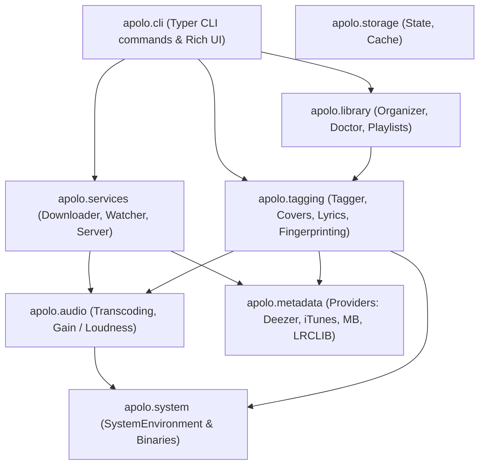

# Architecture & Developer Guide

This document describes the internal architecture of Apolo, local development workflows, code quality guidelines, and CI/CD pipelines.

---

## 1. Domain Architecture

Apolo is organized into high-cohesion, decoupled domain packages under `apolo/`:



### Subpackage Responsibilities

* **`apolo.audio`**: Low-level audio processing via `ffmpeg` / `ffprobe`. Handles transcoding to Opus, bit-perfect FLAC preservation, and EBU R128 loudness calculation.
* **`apolo.tagging`**: Reads, writes, and embeds Vorbis comments and FLAC picture blocks (`mutagen`). Manages cover art extraction/resizing, synchronized lyrics retrieval, and acoustic fingerprinting with `fpcalc` and AcoustID.
* **`apolo.library`**: High-level library operations. Includes `LibraryOrganizer` (template-based path generation), `LibraryDoctor` (health audits, anomaly controls, and batch repairs), and `PlaylistManager` (smart M3U8 generation and DAP export).
* **`apolo.metadata`**: Client implementations for external music APIs (Deezer, iTunes, MusicBrainz, LRCLIB) and metadata candidate ranking algorithms.
* **`apolo.services`**: Asynchronous/background daemons. Includes `Downloader` (`yt-dlp` wrapper), `Watcher` (inbox monitor with debounce), and `Server` (FastAPI REST backend).
* **`apolo.system`**: Centralized host environment inspection (`SystemEnvironment`) ensuring required binaries (`ffmpeg`, `ffprobe`, `fpcalc`, `notify-send`) exist before invocation.
* **`apolo.cli`**: Typer command registration, argument parsing, interactive candidate review menus, and Rich console formatting.

---

## 2. Local Development Environment

We recommend [uv](https://github.com/astral-sh/uv) for fast and deterministic local development:

```bash
# Clone the repository
git clone https://github.com/hypr/apolo.git
cd apolo

# Create virtual environment with Python 3.14 (or >= 3.11)
uv venv --python 3.14
source .venv/bin/activate

# Install Apolo in editable mode with development dependencies
uv pip install -e ".[dev]"
```

---

## 3. Running Test Suites

Apolo maintains comprehensive automated test coverage across all domain modules:

```bash
# Run complete test suite
uv run pytest tests

# Run specific domain tests
uv run pytest tests/test_audio.py
uv run pytest tests/test_tagging.py
uv run pytest tests/test_library.py
uv run pytest tests/test_doctor.py
uv run pytest tests/test_server.py
```

### Test Configuration (`pyproject.toml`)
Tests are pre-configured with:
```toml
[tool.pytest.ini_options]
testpaths = ["tests"]
pythonpath = ["."]
```

---

## 4. Code Formatting & Linting

Apolo enforces strict code style, formatting, and modern typing standards via [Ruff](https://github.com/astral-sh/ruff).

### Code Style Specifications
* **Target Version**: Python 3.11+ (modern native generic typing: `list[str]`, `dict[str, Any]`, `X | None`).
* **Line Length**: `100` characters.
* **Import Sorting**: Automated `isort` convention.

### Running Checks Locally

```bash
# Run linter
uv run ruff check .

# Automatically fix linting and import ordering
uv run ruff check --fix .

# Verify code formatting
uv run ruff format --check .

# Auto-format all files
uv run ruff format .
```

---

## 5. Continuous Integration (CI/CD)

The GitHub Actions workflow at [`.github/workflows/ci.yml`](../.github/workflows/ci.yml) automatically validates all commits and pull requests against:

1. **Host Binary Dependencies**: Installs `ffmpeg`, `libchromaprint-tools`, and `libnotify-bin`.
2. **Code Linting & Formatting**: Executes `ruff check` and `ruff format --check`.
3. **Automated Test Execution**: Runs `pytest tests` on Python 3.14.
